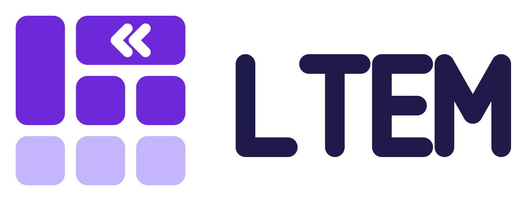

# The LTEM logo

The official files of the LTEM logo. "LTEM" and the LTEM logo are trademarks of EurekaAI Co., Ltd.; [`TRADEMARK.md`](../../TRADEMARK.md) says where you may use them. Use the files unchanged.

<picture>
  <source media="(prefers-color-scheme: dark)" srcset="lockup/ltem-lockup-horizontal-dark.svg">
  
</picture>

## What the symbol shows

The symbol draws the header of the example table in the LTEM README:

```
| Region | Revenue | <<  |
| ^^     | Q1      | Q2  |
|--------|---------|-----|
```

The left cell covers both header rows, and the cell at the top right covers two columns, marked with LTEM's `<<`. Violet cells are header cells; lavender cells are body cells.

## Files

| Folder | Files | Use |
|---|---|---|
| [`symbol/`](symbol/) | `ltem-symbol.svg` | The symbol, on light backgrounds |
| | `ltem-symbol-dark.svg` | On dark backgrounds |
| | `ltem-symbol-mono-black.svg`, `ltem-symbol-mono-white.svg` | Where only one colour is possible |
| | `ltem-symbol-16px.svg`, `ltem-symbol-32px.svg` (and `-dark`) | Drawn for 16 and 32 pixels |
| | `ltem-tile.svg` | On a square tile, for profile pictures and app icons |
| [`wordmark/`](wordmark/) | `ltem-wordmark.svg`, `-black.svg`, `-white.svg` | The word LTEM alone |
| [`lockup/`](lockup/) | `ltem-lockup-horizontal*.svg` | Symbol and word side by side, for page headers |
| | `ltem-lockup-stacked*.svg` | Symbol above the word, for square spaces |
| | `ltem-lockup-fullname*.svg` | With the full name, for first introductions and slides |
| [`badge/`](badge/) | `ltem-badge.svg` | A small badge (20 pixels high) for the README of an implementation that may use the name |
| [`png/`](png/) | Symbol 16–1024 px, tile 128–1024 px, lockups 1200 px wide, badge at 2× | Where SVG cannot be used |

Files ending in `-dark` are for dark backgrounds; `-mono-black` and `-mono-white` use one colour.

## Colours

| Name | Colour | Use |
|---|---|---|
| LTEM Violet | `#6D28D9` | Header cells of the symbol, on light backgrounds |
| Lavender | `#C4B5FD` | Body cells of the symbol, on light backgrounds |
| Ink | `#1E1B4B` | The word LTEM, on light backgrounds |
| Violet Light | `#A78BFA` | Header cells of the symbol, on dark backgrounds |
| Violet Deep | `#4C3A8C` | Body cells of the symbol, on dark backgrounds |
| Mist | `#F5F3FF` | Pale backgrounds |

## Rules

- **Name.** The full name is written "LLM-friendly Table-Enhanced Markdown", with a lowercase "f", except in a title where every word is capitalized.
- **Clear space.** Keep free space around the symbol of about a quarter of its height.
- **Size.** The symbol at least 16 pixels high, with the pixel versions at 16 and 32 pixels. The horizontal lockup at least 120 pixels wide.
- **Do not:**
  - stretch, rotate or recolour the logo, or change its cells, their order or the gaps between them;
  - add gradients, shadows or outlines;
  - replace `<<` with another sign, or add other signs;
  - use a light-background version on a dark background;
  - combine the logo with another name or logo into one unit.

## License

These files are **not** covered by the MIT License of this repository. Their use is governed by [`TRADEMARK.md`](../../TRADEMARK.md).

Copyright © 2026 EurekaAI Co., Ltd. The full name and the badge lettering are outlines of Noto Sans CJK KR and Noto Sans Mono (SIL Open Font License 1.1); no font files are included.
