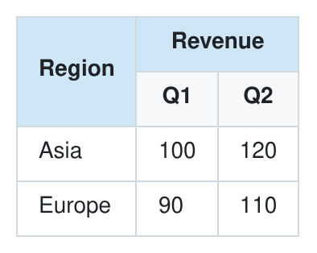

# LTEM and other merged-cell table syntaxes

Markdown has no standard way to merge cells, so different tools have grown their own syntaxes. This page compares LTEM with the main ones by writing one table in each. Every example was rendered with the tool named, and each one gives the table below. (For CSV, HTML and LaTeX in general, see the [taxonomy](../research/taxonomy.md#how-formats-compare).)

```ltem
| Region | Revenue | <<  |
| ^^     | Q1      | Q2  |
|--------|---------|-----|
| Asia   | 100     | 120 |
| Europe | 90      | 110 |
```



The table needs a cell that spans two columns ("Revenue"), a cell that spans two rows ("Region"), and two header rows. The LTEM source is above.

## MultiMarkdown style

```text
| Region | Revenue  ||
| ^^     | Q1  | Q2  |
|--------|-----|-----|
| Asia   | 100 | 120 |
| Europe | 90  | 110 |
```

Rendered with markdown-it-multimd-table 4.2.3, with its `rowspan` option on.

- An extra pipe at the end of a cell merges it with the next column. `^^` merges a cell with the one above, but only when the plugin's `rowspan` option is on (it is off by default). MultiMarkdown itself documents column spans only.
- Every row above the delimiter row is a header row, as in LTEM.
- In GFM, and in LTEM, `||` is an empty cell. Here it is a merge: `| 1 || 3 |` makes "1" span two columns. The same text means a missing value in one tool and a merged cell in another.

## Grid tables

```text
+--------+-----------+
| Region | Revenue   |
|        +-----+-----+
|        | Q1  | Q2  |
+========+=====+=====+
| Asia   | 100 | 120 |
+--------+-----+-----+
| Europe | 90  | 110 |
+--------+-----+-----+
```

Rendered with Pandoc 3.9 and with Docutils 0.19 (reStructuredText).

- The table is drawn with borders, and a cell spans the columns and rows that no border divides. Pandoc reads cell spans in grid tables since version 2.19, and reStructuredText grid tables have them too.
- Cells can hold block content: several paragraphs, lists, code. LTEM cells hold inline content, with `\\` for line breaks.
- The table is a two-dimensional drawing. A cell's text runs over several lines, and every border must stay lined up, so a longer value means redrawing the column. Renderers without grid-table support, such as GitHub, show the drawing as a paragraph of text.

## HTML

```html
<table>
<thead>
<tr><th rowspan="2">Region</th><th colspan="2">Revenue</th></tr>
<tr><th>Q1</th><th>Q2</th></tr>
</thead>
<tbody>
<tr><td>Asia</td><td>100</td><td>120</td></tr>
<tr><td>Europe</td><td>90</td><td>110</td></tr>
</tbody>
</table>
```

- HTML can express any table, and GitHub shows it. Many other Markdown renderers turn raw HTML off for safety.
- Here it takes about twice the tokens of LTEM, and a reader has to work out from `rowspan` and `colspan` where each cell sits.

## Syntaxes without several header rows

Two more styles merge cells in pipe tables, but have one header row, so they cannot write the table above.

**Caret style**, in Swift-DocC (since 2022): extra pipes merge with the next column, and `^` merges with the cell above.

```text
| Sloth colors              || Sloth powers              ||
| ------------ | ------------ | ------------ | ------------ |
| Stormy       | Gray         | Wind         | Rain         |
| ^            | Light blue   | Ice          | Snow         |
```

**Arrow style**, in Markdown Preview Enhanced and the remark-extended-table plugin: a cell holding only `>` merges with the cell to its right, and `^` with the cell above.

```text
| header1          | header2          |
| ---------------- | ---------------- |
| cell (rowspan=2) | cell             |
| ^                | cell             |
| >                | cell (colspan=2) |
```

## Side by side

| Syntax | Column span | Row span | Several header rows | One line per row | On GitHub | Tokens for the table above |
|---|---|---|---|---|---|---|
| LTEM | `<<`, `{c:N}` | `^^`, `{r:M}` | Yes | Yes | A table; markers show as text, and header rows above the last one show above it | 48 |
| MultiMarkdown style | extra pipe | `^^` (option) | Yes | Yes | The same as LTEM | 45 |
| Grid tables | drawn | drawn | Yes | No | A paragraph of text | 70 |
| HTML | `colspan` | `rowspan` | Yes | Not required | A table | 99 |
| Caret style | extra pipe | `^` | No | Yes | A table; `^` shows as text | — |
| Arrow style | `>` | `^` | No | Yes | A table; `>` and `^` show as text | — |

Tokens are counted with the o200k_base tokenizer, as in the paper, for the sources exactly as written on this page.

## Why LTEM writes it this way

LTEM is written for two readers at once: language models, which read and write tables as a stream of tokens, and people, who read the source by eye. Its syntax follows five design principles from the paper (Section 4.1).

1. **Markdown compatibility.** Models have seen a great many Markdown tables in their training data and write tables in Markdown by default, and people know them from everyday writing. LTEM builds on GFM pipe tables: a GFM table is an LTEM table with the same meaning, but for a few rare cases. A model or a person who knows Markdown tables already knows most of LTEM, and a renderer without LTEM still shows the rows and columns. Grid tables and HTML give this up.

2. **Explicit structure.** Written with markers, a merge shows in every position it covers, so nothing has to be worked out. `<<` and `^^` point to the cell they join, and read naturally as "same as the cell to the left" and "same as the cell above". In HTML, a reader has to count `colspan` and `rowspan` values to find where a cell sits; the paper names this inference as a source of structural mistakes by models. An extra pipe, as in MultiMarkdown style, looks like an empty cell, and GFM reads it as one; `<<` is never mistaken for an empty cell.

3. **Linear readability.** Each row is one line, and the table reads from top to bottom, the way a model reads and writes text and the way a person scans it. There are no borders to keep lined up, as in grid tables. Written with markers, every row has one cell per column, so the columns line up in the source as well.

4. **Minimal grammar extension.** LTEM adds only a few things to GFM tables: `<<`, `^^`, `{c:N}` and `{r:M}`, `\`, and several header rows. Some of them are shared with existing styles: `^^` with MultiMarkdown style, and header rows above the delimiter row with MultiMarkdown style and grid tables. Little syntax means little to learn and few tokens: the table on this page takes 48 tokens in LTEM, 70 as a grid table and 99 in HTML. In the paper's experiments with five language models, questions about LTEM tables were answered as accurately as about HTML tables, while the tables took about 40% fewer tokens.

5. **Unidirectional parsing.** No row depends on the rows below it, so a table is read in one pass. A renderer can show a table row by row as it streams in from a model (see [Showing LTEM as it streams](../docs/guide.md#showing-ltem-as-it-streams)).

Two more choices follow from these principles:

- **Markers first, attributes for wide spans.** `{c:N}` and `{r:M}` save writing ten markers for a cell across ten columns. In the paper's comparison with GPT-5, the two forms gave no significant difference in accuracy (Appendix G.2), so LTEM keeps markers as the main form for compatibility and readability, and tools that write LTEM use them.
- **Exact rules.** A specification with conformance tests defines every case, and libraries in three languages pass the same tests. The other pipe-table styles are each defined by the documentation of one tool.
