# Writing LTEM tables

LTEM is a Markdown pipe table, as on GitHub, with three additions: merged cells, several header rows, and line breaks inside a cell. If you can write a Markdown table, you can write LTEM.

This guide shows how, with examples. Each example is followed by a picture of the table it renders to; merged cells are shaded in the pictures. The [specification](../spec/ltem-spec.md) is the reference: where this guide simplifies, the specification decides.

## The notation at a glance

| Write | Meaning |
|---|---|
| `<<` as the whole cell | Merge with the cell to the left |
| `^^` as the whole cell | Merge with the cell above |
| Rows above the `\|---\|` row | Header rows; there may be several |
| `{c:N}`, `{r:M}` or `{c:N,r:M}` at the end of a cell | The cell spans N columns, M rows, or both |
| `\\` | A line break inside a cell |
| `\<<`, `\^^`, `\{c:2}` | The text `<<`, `^^`, `{c:2}` |

## Start from a Markdown table

```ltem
| Region | Q1  | Q2  |
|--------|-----|-----|
| Asia   | 100 | 120 |
| Europe | 90  | 110 |
```

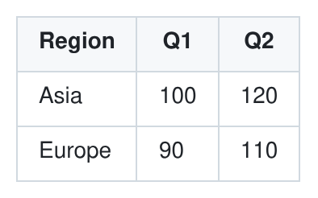

This GitHub (GFM) table is already an LTEM table, with the same meaning. The few rare exceptions are listed in [Section 1.2](../spec/ltem-spec.md#12-relation-to-commonmark-and-gfm) of the specification. The usual rules hold:

- The `|---|` row, the delimiter row, sets the number of columns and their alignment: `:---` left, `---:` right, `:---:` center.
- Pipes at the start and end of a row are optional, but write them. They make rows easier to read, and header rows above the last one need the leading pipe (see [Several header rows](#several-header-rows)).
- Write `\|` for a pipe inside a cell, also inside code and formulas.
- Spaces that line up the columns have no meaning. Add them or leave them out.
- Leave a blank line before and after the table. A line that starts with a pipe directly above a table becomes one of its header rows.

## Merge across columns: `<<`

A cell that holds only `<<` merges with the cell to its left. Several `<<` in a row make a wider cell.

```ltem
| Item  | Specs         | <<    | <<    |
|-------|---------------|-------|-------|
| Phone | 6.1"          | 170 g | 128GB |
| Note  | Same as phone | <<    | <<    |
```

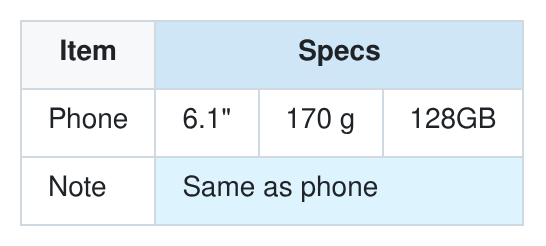

"Specs" spans three columns in the header, and so does "Same as phone" in the body.

## Merge down rows: `^^`

A cell that holds only `^^` merges with the cell above it.

```ltem
| Region | Product | Sales |
|--------|---------|-------|
| Asia   | Phone   | 1.2M  |
| ^^     | Laptop  | 0.8M  |
| Europe | Phone   | 0.9M  |
```

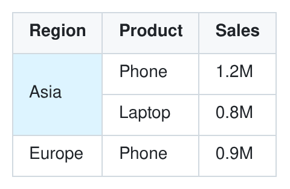

"Asia" covers two rows.

## Merge a block

For a cell that spans both ways, write `<<` to its right in its first row, `^^` below it, and `<<` in the rest of the block:

```ltem
| Team  | Mon     | Tue | Wed |
|-------|---------|-----|-----|
| Alpha | Offsite | <<  | Lab |
| Beta  | ^^      | <<  | Lab |
```

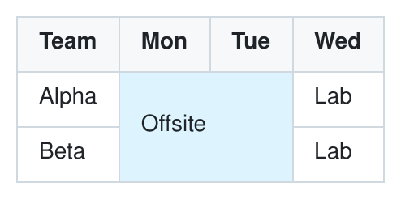

"Offsite" covers two columns and two rows.

## Several header rows

Every row above the delimiter row is a header row. Header cells that group the cells below them use the same markers:

```ltem
| Region | Revenue | <<  | Cost | <<  |
| ^^     | Q1      | Q2  | Q1   | Q2  |
|--------|---------|-----|------|-----|
| Asia   | 100     | 120 | 60   | 70  |
| Europe | 90      | 110 | 55   | 65  |
```

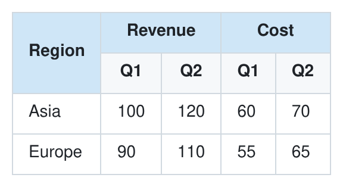

"Revenue" and "Cost" each span two columns, and "Region" spans both header rows.

Two rules apply to header rows:

- Every header row above the last one must begin with a pipe. A line without a leading pipe ends the header rows and stays an ordinary paragraph.
- A header cell does not reach into the body. A `^^` in the first body row does not merge with the header above it; it stays the text `^^`.

## Span attributes: `{c:N}` and `{r:M}`

Instead of markers, a cell can state its size at its end: `{c:N}` for N columns, `{r:M}` for M rows, and `{c:N,r:M}` for both. Put a space before the attribute, or make it the whole cell, and put no spaces inside the braces. `Revenue {c:2}` spans two columns; `Revenue{c:2}` is just text.

The positions that the cell covers can be written in two ways:

- **With placeholders:** every column gets a cell in the row, and the covered positions hold empty cells (or markers).
- **Without them:** the covered positions are left out.

LTEM tells the two apart by counting the cells of the row against the columns of the delimiter row. Both tables below render to the same table:

```ltem norender
| Revenue {c:2} |     | Total |
|---------------|-----|-------|
| 100           | 120 | 220   |
```

```ltem
| Revenue {c:2} | Total |
|-------|-----|-------|
| 100   | 120 | 220   |
```

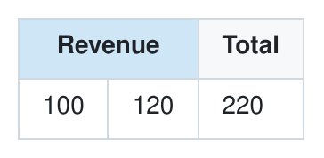

Which to use:

- **Markers** keep every row the same width, so the columns line up in the source. That makes a table easier to check by eye.
- **Attributes** are shorter for wide spans, such as a title across ten columns.

In the paper's comparison with GPT-5, question-answering accuracy did not differ significantly between the two forms (Appendix G.2). Tools that write LTEM use markers (see [Canonical form](#canonical-form)).

## Line breaks in a cell: `\\`

Two backslashes break a line inside a cell:

```ltem
| Name  | Address               |
|-------|-----------------------|
| Alice | 123 Main St \\ Apt 4B |
```

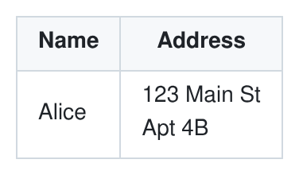

Lists, checkboxes and formulas in a cell are written as lines:

```ltem
| Feature | Details                          | Status      |
|---------|----------------------------------|-------------|
| Speed   | - 2x faster \\ - 50% less memory | [x] Done    |
| Formula | $E = mc^2$                       | [ ] Pending |
```

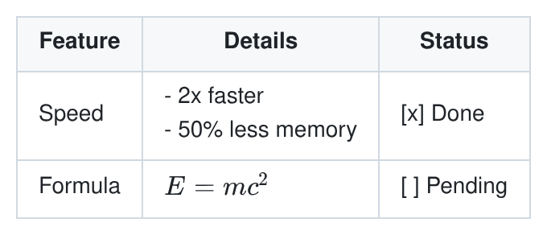

`\\` always means a line break, even inside code and formulas. So LTEM 1.0 cannot put two backslashes in a row into a cell, as a LaTeX matrix would need ([Appendix B](../spec/ltem-spec.md#appendix-b-not-in-version-10)).

## Section rows

A body row whose first cell spans all columns labels the rows below it. It splits one table into sections that share the same columns:

```ltem
| Test        | Result         | Reference |
|-------------|----------------|-----------|
| Blood count | <<             | <<        |
| Hemoglobin  | 14.2 g/dL      | 13.5–17.5 |
| Platelets   | 250 ×10³/µL    | 150–400   |
| Lipids      | <<             | <<        |
| LDL         | 110 mg/dL      | below 130 |
```

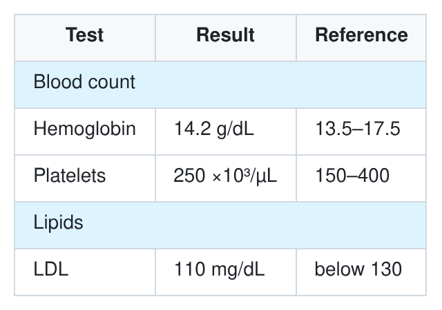

## Tables without a header

An LTEM table always has a header row. For a table without one, write a header row of empty cells:

```ltem
|        |        |
|--------|--------|
| Plan A | Expand |
| Plan B | Review |
```

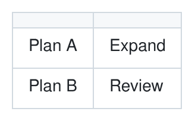

Tools may read a header row of empty cells as "no header".

## Text that looks like notation

When the text of a cell should be `<<` or `^^`, or should end in something like `{c:2}`, put a backslash in front: `\<<`, `\^^`, `\{c:2}`. These are ordinary Markdown escapes, so renderers without LTEM show the same text.

```ltem
| Operator | Example  |
|----------|----------|
| \<<      | x \{c:2} |
| \^^      | a << b   |
```

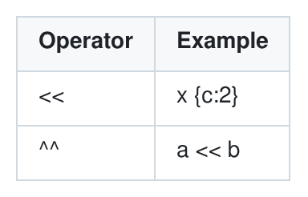

`a << b` needs no escape: only a cell that is exactly `<<` is a marker.

LTEM reads only the ASCII characters `<<` and `^^`. Some word processors and keyboards turn `<<` into `«`, which is text.

## Formulas and other inline content

Cell text is ordinary Markdown inline content: emphasis, links, code and, where the renderer supports it, math. LTEM leaves all of it to the Markdown processor.

For math in `$...$`, the specification recommends Pandoc's rule: no space right after the opening `$` or right before the closing one, and no digit right after the closing one. Prices such as `$10 ~ $20` then stay text. A pipe inside a formula still needs `\|`, as in `$\|r\| < 1$`.

## When something is wrong

A renderer never rejects a table. If a table breaks a rule, the renderer still shows it, in a defined way, but perhaps not as you meant. A validator points out each problem and where it is. The common cases:

| You wrote | What happens |
|---|---|
| `^^` in the first body row, below a header cell | It stays the text `^^`: a header cell does not reach into the body. |
| `<<` in the first column, or `^^` in the first row | It stays text: there is no cell to merge with. |
| Text where a span already reaches, such as `Q2` right after `Revenue {c:2}` | The text is dropped. |
| A span past the edge, such as `{c:3}` in the last column | The span is cut at the edge. |
| Two cells that overlap | The span placed later is cut. |
| `{c:0}`, or a key twice, as in `{c:2,c:3}` | 0 counts as 1; the first key counts. |
| A row with too few or too many cells | It is padded or cut, as in GFM. |
| `x{c:2}`, without a space | Text, not a span. |
| `«` instead of `<<` | Text. |

The exact rules are in [Section 5](../spec/ltem-spec.md#5-validation-rules) of the specification.

## Canonical form

Tools that write LTEM, such as converters and formatters, produce one standard text for each table, the canonical form ([Section 8](../spec/ltem-spec.md#8-canonical-form)):

- every row has a cell for every column
- a covered position is `^^` in the column where its cell starts, and `<<` elsewhere
- no span attributes
- one space before and after the text of each cell, and `---` in the delimiter row

```ltem
| Region | Revenue | << |
| ^^ | Q1 | Q2 |
| --- | --- | --- |
| Asia | 100 | 120 |
```

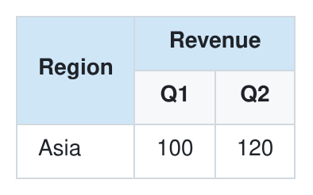

You need not write tables this way yourself. Padding that lines up the columns is fine.

## In renderers without LTEM support

Until LTEM is widely supported, many readers will see LTEM tables in renderers that know only GFM, such as GitHub. Such a renderer still shows the cells in rows and columns, with the LTEM notation as text: `<<` and `^^` read as "same as the cell to the left" and "same as the cell above", and `\\` shows as a single backslash. Two things need care. In the pictures below, the left side is rendered with LTEM, and the right side by cmark-gfm, the GFM renderer that GitHub uses.

**Several header rows.** A GFM table has one header row: the line right above the `|---|` row. The header rows above it show as a line of text above the table:

```ltem compare
| Region | Revenue | <<  |
| ^^     | Q1      | Q2  |
|--------|---------|-----|
| Asia   | 100     | 120 |
| Europe | 90      | 110 |
```

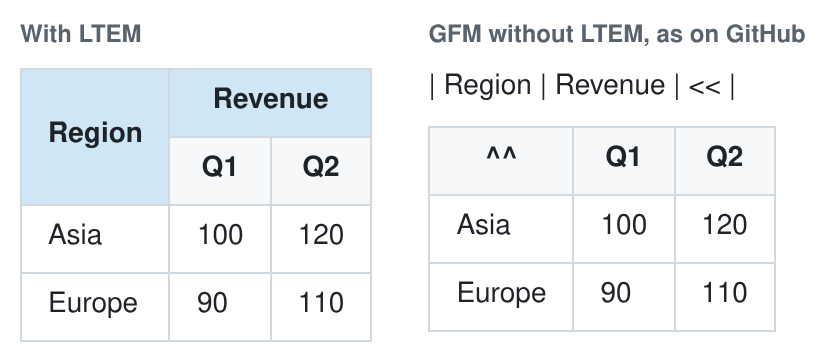

The last header row usually holds the most specific labels, such as Q1 and Q2, so the table still reads. A label that spans all header rows, such as "Region", shows in the GFM header only as `^^`. If many readers will see the table without LTEM, put such a label in the last header row and leave the cells above it empty: LTEM renderers then show an empty corner above it, and GFM renderers show it in the header.

**Positions left out.** GFM pads a short row with empty cells at its end, so the cells after a left-out position move into the wrong columns. If the last header row leaves positions out, GFM shows no table at all.

```ltem compare
| Product     | Quarter | Sales |
|-------------|---------|-------|
| Phone {r:2} | Q1      | 100   |
| Q2          | 120     |
```

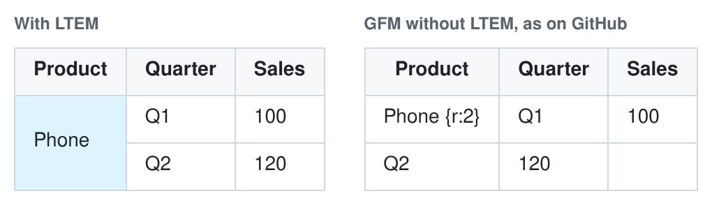

Give every row one cell per column, with `<<` and `^^` in the merged positions, as the canonical form does. Write empty cells with a space, `|  |`: MultiMarkdown and some other Markdown extensions read `||` as a column span.

Where most readers see GFM, as in a README on GitHub, one sentence below the first table helps:

> This table is written in [LTEM](https://github.com/hugman/ltem): `<<` merges a cell with the cell to its left, and `^^` with the cell above.

## Using LTEM with LLMs

LLMs know Markdown tables well. Until LTEM is widely known, put a short note on its syntax at the start of the prompt; with it, models read and write LTEM. As LTEM spreads and more models learn it, we expect them to understand it without the note, as they understand Markdown tables today.

The two prompts below are complete. Their first six lines are the same note; copy them as they are.

### Asking about an LTEM table

```text render
LTEM is Markdown pipe tables with merged cells:
- A cell that is exactly << is merged with the cell to its left.
- A cell that is exactly ^^ is merged with the cell above.
- A cell that ends in {c:N} spans N columns; {r:N} spans N rows.
- All rows above the |---| row are header rows.
- \\ in a cell is a line break.
The table below is in LTEM. Resolve the merges first, then answer from the resolved table.

| Model   | Display | <<   | Battery   |
| ^^      | Size    | Type | ^^        |
|---------|---------|------|-----------|
| Phone A | 6.1"    | OLED | 3,300 mAh |
| Phone B | ^^      | LCD  | 4,000 mAh |
| Phone C | 6.7"    | OLED | ^^        |

Question: Which phones have a 6.1" display, and how large is the battery of Phone C?
```

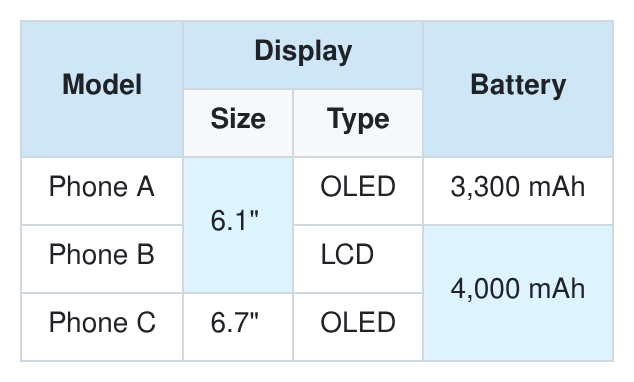

The picture shows the table in the prompt. Expected answer: Phone A and Phone B; 4,000 mAh. Both parts come from merged cells: Phone B shares the 6.1" display with Phone A, and Phone C shares the battery of Phone B. The paper's experiments added a similar note to the prompt for LTEM inputs (Appendix D).

### Asking for an LTEM table

```text
LTEM is Markdown pipe tables with merged cells:
- A cell that is exactly << is merged with the cell to its left.
- A cell that is exactly ^^ is merged with the cell above.
- A cell that ends in {c:N} spans N columns; {r:N} spans N rows.
- All rows above the |---| row are header rows.
- \\ in a cell is a line break.
Write tables in LTEM. Use << and ^^ rather than {c:N} and {r:N}, and give every row one cell per column.

Make a table of these results. Group Acc and F1 under each dataset, and group the models by family.
- Encoder, Small: Dataset A Acc 81.2, F1 79.5; Dataset B Acc 74.0, F1 71.8
- Encoder, Large: Dataset A Acc 85.6, F1 84.1; Dataset B Acc 78.3, F1 76.9
- Decoder, Small: Dataset A Acc 80.4, F1 78.8; Dataset B Acc 75.2, F1 73.0
- Decoder, Large: Dataset A Acc 86.9, F1 85.7; Dataset B Acc 80.1, F1 78.4
```

Expected output:

```ltem
| Family  | Model | Dataset A | <<   | Dataset B | <<   |
| ^^      | ^^    | Acc       | F1   | Acc       | F1   |
|---------|-------|-----------|------|-----------|------|
| Encoder | Small | 81.2      | 79.5 | 74.0      | 71.8 |
| ^^      | Large | 85.6      | 84.1 | 78.3      | 76.9 |
| Decoder | Small | 80.4      | 78.8 | 75.2      | 73.0 |
| ^^      | Large | 86.9      | 85.7 | 80.1      | 78.4 |
```

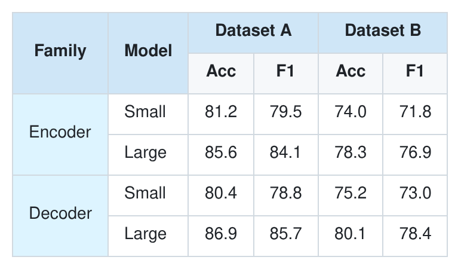

Check what a model writes with a validator. It catches slips such as a `^^` below a header cell or a row with a missing cell.

### Showing LTEM as it streams

Chat interfaces show an answer while it is still arriving, and most of them render its Markdown again as each piece comes in. With an LTEM renderer this works as it is. LTEM reads from top to bottom, and no row depends on the rows below it, so rendering the partial text again is cheap, and the rows already shown keep their meaning. Three things to know:

- **A table starts with its delimiter row.** Until the `|---|` row has arrived, the header rows are ordinary lines of text. They show as text, then turn into the table header. To avoid the jump, an interface may hold back lines that start with a pipe at the end of the answer until it knows what they are.
- **The last line may still change.** `| Europe | ^` shows a `^` in the cell, and becomes a merge once the second `^` arrives; a half-written delimiter row such as `|--------|---` does not start a table yet. Render complete lines, and show the last line when its line break arrives or the answer ends.
- **New rows can change the cells above them.** A `^^` makes the cell above it taller. A cell with `{r:M}` reaches into rows that have not arrived yet; until they do, it is cut at the last row, and a validator reports it. Render the whole table again on each line, and validate only the finished answer.

## More examples

A timetable with a double period and a row across all days:

```ltem
| Time  | Mon     | Tue     | Wed     |
|-------|---------|---------|---------|
| 09:00 | Math    | Physics | Math    |
| 10:00 | ^^      | ^^      | History |
| 12:00 | Lunch   | <<      | <<      |
| 13:00 | English | Art     | Music   |
```


A statement with sections, a two-level header and right-aligned numbers:

```ltem
| Item     | 2025  | <<    | 2026  | <<    |
| ^^       | H1    | H2    | H1    | H2    |
|:---------|------:|------:|------:|------:|
| Income   | <<    | <<    | <<    | <<    |
| Sales    | 1,200 | 1,350 | 1,410 | 1,520 |
| Services | 300   | 320   | 340   | 360   |
| Expenses | <<    | <<    | <<    | <<    |
| Staff    | 600   | 620   | 650   | 670   |
| Rent     | 120   | 120   | 125   | 125   |
```

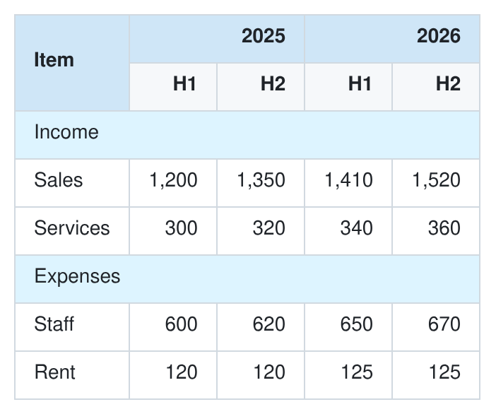

## Further reading

- [LTEM specification](../spec/ltem-spec.md): the exact rules, with 46 tested examples
- [Taxonomy of table structural complexity](../research/taxonomy.md): which table structures LTEM covers, and why
- [LTEM and other merged-cell table syntaxes](comparison.md): how LTEM differs from MultiMarkdown style, grid tables and HTML
